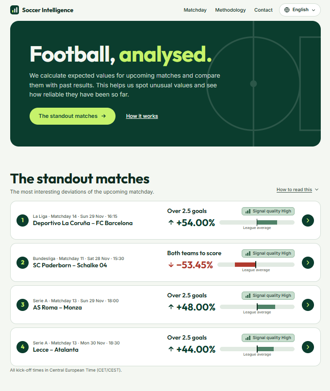
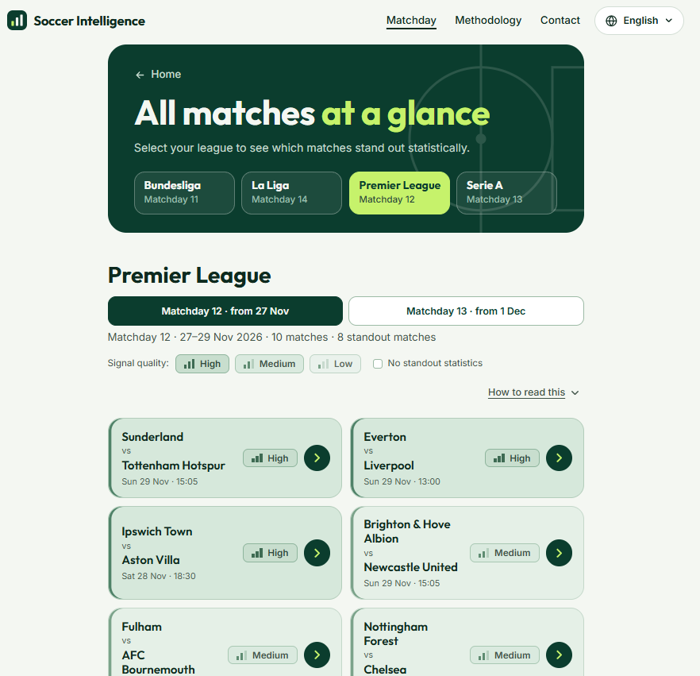
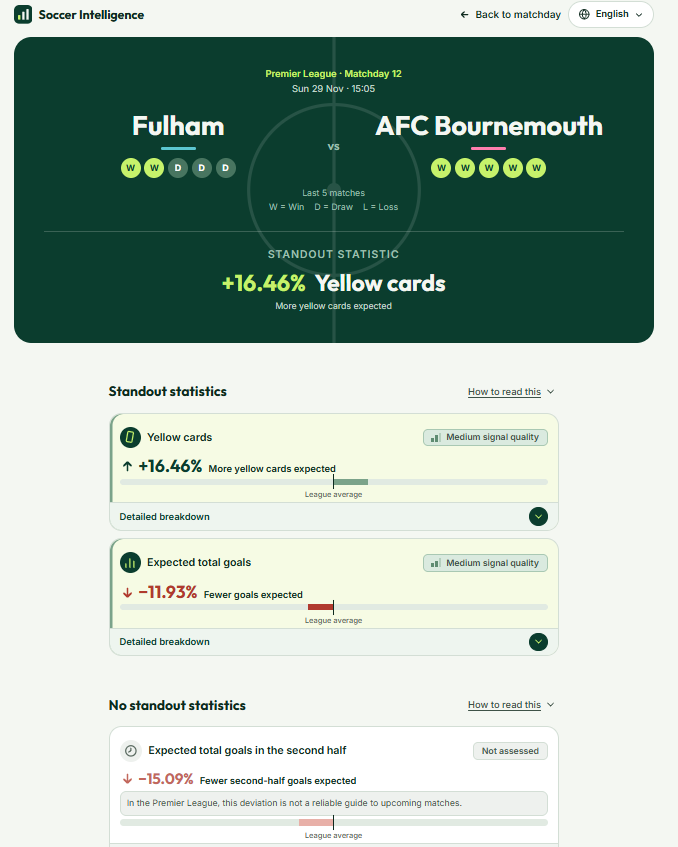
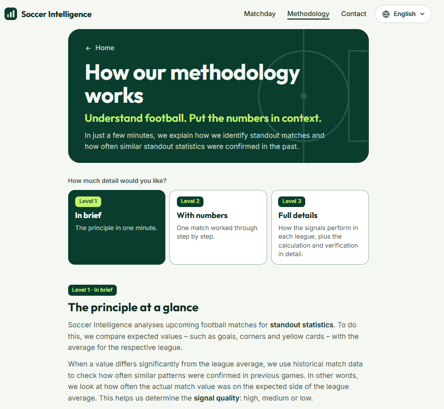

# Soccer Intelligence – A Personal Football Analytics Project

**Football, analysed.**

Soccer Intelligence started as a **personal learning project** driven by two interests: football and data.

I wanted to find out how programming, data analysis and statistical methods could be used to look at football matches from a different perspective. What began as a way to develop new skills gradually grew into an independent football analytics platform that anyone can visit.

🌐 **[Visit soccer-intelligence.com](https://soccer-intelligence.com)**

---

## About the Project

Football produces a huge amount of data: goals, corners, yellow cards, shots on target and much more. Each number tells part of the story.

**But how can these numbers be put into context?**

That question is behind Soccer Intelligence. For every upcoming match, the platform calculates expected values from both teams' recent league matches and compares them with the league average. Where a value differs clearly from the average, the match is highlighted, together with a note on how often similar cases were confirmed in the past.

Soccer Intelligence currently covers four major European leagues:

- Bundesliga
- Premier League
- Serie A
- LaLiga

The website is available in **English and German**.

This is an **independent, non-commercial personal project**. It is first and foremost a way to learn, experiment and build something around a subject I genuinely enjoy – and to share the result with other football fans who might find this perspective interesting.

---

## What You Can Explore

### 1. The Standout Matches

The homepage shows the most interesting deviations of the upcoming matchday at a glance – for example in **Over 2.5 goals**, **Both teams to score**, **expected total goals**, **corners** or **yellow cards**.

Each deviation is shown as a percentage compared with the league average, together with its **signal quality** (high, medium or low). Signal quality shows how often similar standout statistics were confirmed in past matches.

### 2. Matchday Overview

The matchday page lists all fixtures of the current matchday for each league. Matches with standout statistics are marked by signal quality, so they are easy to spot. Earlier matchdays remain available in an archive with final scores.

### 3. Match Analysis

Every match has its own page with:

- recent form of both teams
- standout statistics with signal quality
- expected values compared with the league average
- a breakdown of all statistics, including those without anything unusual

After the final whistle, the same page compares the **expected values with what actually happened** and shows whether each standout statistic was confirmed.

### 4. Transparent Methodology

Transparency matters to me. The methodology page explains the approach in three levels:

- **Level 1 – In brief:** the basic idea behind the analysis
- **Level 2 – With numbers:** a worked example of the calculations
- **Level 3 – Full details:** all rules, thresholds and the historical check, including a downloadable Excel file

The aim is to make the approach understandable without a background in statistics.

---

## How It Was Built

### Built with the support of AI

Soccer Intelligence was developed with the support of AI, using **Claude Code**. I defined the ideas, rules and calculations, checked the results and made the decisions – and learned a great deal along the way about software development, data processing and running a website.

### Technology

- **Python** – data processing, statistical calculations and the website itself
- **Jinja2, HTML and CSS** – the public website, optimised for mobile devices
- **Streamlit** – an internal dashboard for data quality checks and analysis
- **Docker** – each part of the platform runs in its own container
- **Traefik** – reverse proxy with HTTPS
- **Hostinger VPS** – server and hosting
- **API-Football** – source of fixtures, results and match statistics
- **Automated tests** – more than 800 test cases run before every release

### What happens automatically

- Match data is imported automatically after each match, with a daily control run.
- Values are frozen before kick-off, so the comparison after the match is fair.
- A monitoring script checks the website and server every minute and sends alerts by email if something goes wrong.

---

## The Learning Journey

Building Soccer Intelligence has been a practical way to explore and improve my skills in:

- Python and data processing
- statistical analysis and football statistics
- web development, accessibility and search engine basics
- Docker, servers and deployment
- automated testing and monitoring
- working with AI as a development partner

Rather than following isolated tutorials, I wanted to build something real – a project that combines many different topics and keeps growing through experimentation.

There is still plenty to learn and improve. That is part of what makes it interesting.

---

## A Personal Project, Shared with Others

Soccer Intelligence is not a commercial product or a business.

It is an independent project built out of curiosity, an interest in football and the wish to keep learning.

If you enjoy football, data or technology, feel free to explore the platform. **Feedback, suggestions and ideas are always welcome.**

🌐 **Website:** [soccer-intelligence.com](https://soccer-intelligence.com)

---

*An independent personal learning project. The statistics provide analytical context only and are not predictions or guarantees of future match outcomes. This project does not offer betting advice.*

**Built with curiosity, football and data.**
